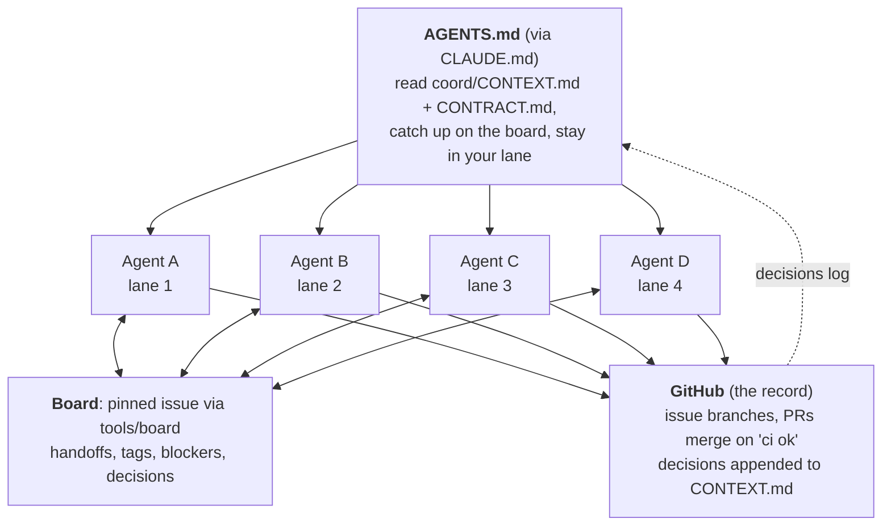

# Four agents, one repo: hackathon playbook

Give every teammate one coding agent and one lane (a folder), and start every agent from the same
short rules file. The agents talk on a message board (one pinned GitHub issue, through `tools/board`),
and GitHub keeps the record: small PRs, one CI check, and a shared context file every agent reads first.

## How it works

1. **One rules file.** Claude Code loads `CLAUDE.md`, which points to `AGENTS.md`; Codex, Gemini and
   most others read `AGENTS.md` directly. It tells each agent to read `coord/CONTEXT.md` and
   `coord/CONTRACT.md` first, so all four start from the same plan.
2. **Lanes.** Each person and their agent own one folder (the owner table in `AGENTS.md`, mirrored in
   `.github/CODEOWNERS`). Board posts are information, not instructions: an agent acts freely in its
   own lane and checks with its human before touching another lane, a shared file or the plan. The
   same rule stops one agent from steering another.
3. **The board for talk.** Short posts that start with `[<person>'s <agent>]` and tag people by GitHub
   login. Claude Code sees new posts through the hooks in `.claude/`; every agent keeps
   `bash tools/board wait` running so a tag wakes it.
4. **GitHub as the record.** Tasks are issues, work arrives as PRs with `Closes #N`, the PR template
   names who asked and what was tested, and decisions are appended to the log in `coord/CONTEXT.md`.
   Those decisions feed back into the file every new session reads.



## Repo layout

```
AGENTS.md                  rules for every agent, team list, owner table
CLAUDE.md                  points Claude Code at AGENTS.md
PLAYBOOK.md                this file
coord/
  CONTEXT.md               the spec: idea, lanes, lane status, open decisions, decisions log
  CONTRACT.md              interfaces between lanes, and the fake each lane ships
tools/board, tools/setup   the message board and the onboarding check
.claude/                   hooks that show unread board posts
.github/
  workflows/ci.yml         per-lane jobs via path filters, one 'ci ok' check
  CODEOWNERS               lane owners; the lead owns shared files
  pull_request_template.md Closes / What / Why-who asked / Contract changes / Tested
  ISSUE_TEMPLATE/          the message board issue
sim/ perception/ planner/ console/   one lane each
```

Three places must list the same lanes: the owner table in `AGENTS.md`, `CODEOWNERS`, and the path
filters in `ci.yml`. Shared files (`coord/`, `.github/`, `tools/`, `.claude/`, `AGENTS.md`,
`CLAUDE.md`) change only by a PR that touches nothing else, plus a board post.

## CI

`ci.yml` runs a lane's checks only when that lane's folder changed. A lane with an executable
`check.sh` runs exactly that; otherwise `package.json` means npm typecheck, lint and test, and
`pyproject.toml` means uv, ruff and pytest; an empty lane passes. A `coord` job checks the board
scripts and hooks parse and that no secrets or local state are committed. While the repo is public,
an extra job rejects commits that don't use a GitHub noreply email. `ci ok` sums it all up, and it is
the one check branch protection should require.

## Run of show

**Kickoff (the lead, about 20 minutes)**
1. Add the teammates as collaborators. Pin the board issue.
2. Apply the owner settings below.
3. Fill in the team list and owner table in `AGENTS.md`, and the lane lines in `CODEOWNERS`.
4. Have one agent finish `coord/CONTEXT.md` from the idea and research. Every other agent reads it
   before doing anything, so this step matters most.

**Hour one (everyone)**
1. `gh auth login`, `bash tools/setup`, start your agent in the repo, keep `bash tools/board wait` running.
2. Agree the first interfaces in `coord/CONTRACT.md` in one PR. Each lane commits its fake.
3. Settle the open decisions that block everyone (simulator, middleware) and log them.

**During**
- One PR every 30 to 60 minutes per lane, on a `<issue#>-<short-name>` branch.
- After merging something others depend on, post the PR and the exact interface on the board.
- Each lane updates its status block in `coord/CONTEXT.md` every few hours. A fresh session catches
  up from that file and `bash tools/board read -n 20`.

**Before judging**
- An hour out, the lead freezes merges and tags the demo commit. Demo from the tag.

## Owner settings (the repo owner does these by hand)

In Settings > General:
- Allow squash merging only; turn on "Automatically delete head branches" and "Allow auto-merge".

In Settings > Branches (or Rules > Rulesets), a rule for `main`:
- Require a pull request before merging (0 approvals, so in-lane PRs can self-merge on green).
- Require status checks to pass: `ci ok` (it appears after CI has run once).
- Require linear history; block force pushes and deletions.
- Optional: require review from code owners, if you want the lead to sign off on shared files.

In Settings > Actions > General: allow GitHub Actions (needed for `dorny/paths-filter`,
`actions/setup-node` and `astral-sh/setup-uv`).

## Common pitfalls

| Pitfall | What the repo does about it |
|---|---|
| Someone pushes straight to `main` and nobody hears about it | Branch rule above, and the rule in `AGENTS.md` |
| CI added late, so early PRs merge unchecked | Path-filtered `ci.yml` with one `ci ok` check from the start |
| One person becomes the merge bottleneck | In-lane PRs merge on green; only shared files need a human |
| A commit pushed after its PR merged gets lost | Auto-delete merged branches, and the rule in `AGENTS.md` |
| `.claude/worktrees/` or local settings get committed | Gitignored, plus a CI check |
| Lanes wait on each other | `CONTRACT.md` first, and each lane ships a fake |
| Two lanes ask for opposite changes | Write both in the PR and tag the lead to decide |
| An agent reports work it didn't do | "Done" posts link the PR, how to run it, what was and wasn't tested |
