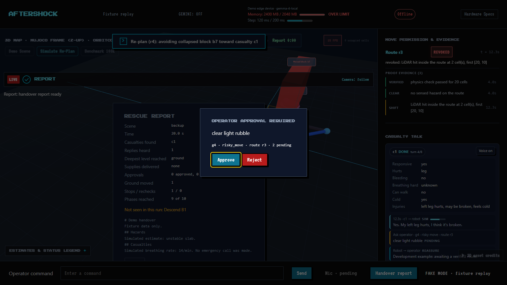
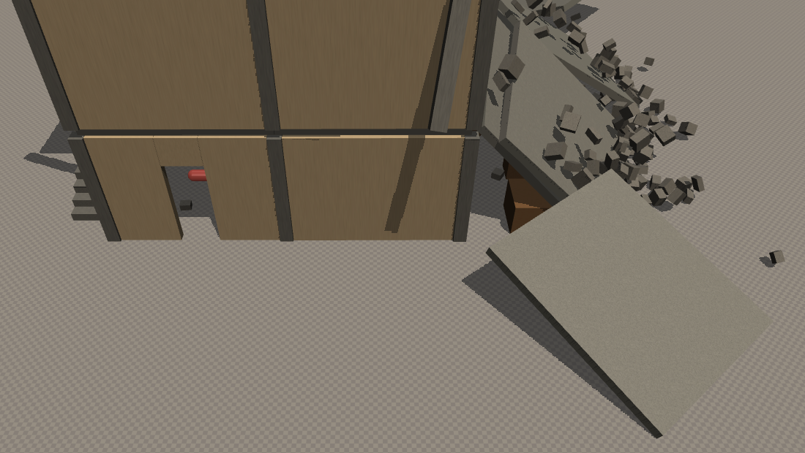
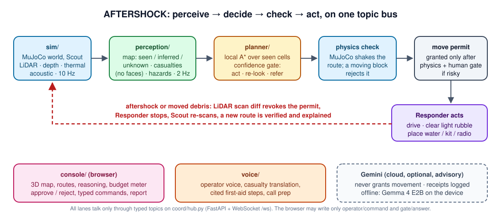

<p align="center">
  
</p>

<p align="center"><b>Two robots, one collapsed building. Map it first, check every route with physics, and only then send help in.</b></p>

<p align="center">
  
  
  
  
  
  
  
</p>

<p align="center">
  📄 <b><a href="docs/technical-summary.pdf">One-page technical summary (PDF)</a></b> · 📐 <a href="docs/aftershock.md">Full spec</a> · 🏗️ <a href="#️-architecture">Architecture</a> · 🛠️ <a href="#️-run-it-yourself">Run it yourself</a>
</p>

| 🛰️ Sees before it sends | 🧱 Physics, not a chatbot, says "go" | 🔁 Adapts when the building moves |
|---|---|---|
| A light Scout rover maps the ruin with LiDAR, depth, thermal and sound. Every map cell is marked *seen*, *inferred* or *unknown*, and only seen-free cells may carry a route | Every Responder route is shaken in MuJoCo before it is allowed. A block that would move rejects it. A model answer never authorises movement: physics and a human-approved permit do | When an aftershock hits or debris moves, a LiDAR scan diff revokes the route, the Responder stops on the spot, the Scout re-scans and a new verified route appears with a one-line reason |

# 🏚️ AFTERSHOCK: _search and rescue that checks before it moves_

> **AFTERSHOCK is a two-robot search-and-rescue agent for collapsed buildings, built in simulation for the AgentVerse 2026 Robotics track (UCL AI Society, 7 to 8 November 2026).** A small Scout rover goes in first and builds a live 3D map. The system finds casualties from body pose, heat and sound, and predicts which parts of the building may fail next. A stronger Responder robot is then sent along the safest route, but only after that route has passed a physics check in MuJoCo and, for anything risky, an explicit "yes" from the human operator. It brings water, a first aid kit or a radio, clears light rubble, and talks to the casualty in their own language. When the building changes, the system notices, stops, re-checks and explains itself. At the end it writes a one-page handover report for the next team in. The core loop runs on the device; cloud models are optional advisers.

<details open>
<summary><b>📑 Contents</b> (click to collapse)</summary>

- [📖 Overview](#-overview)
- [🎯 The problem](#-the-problem)
- [🧭 A 2-minute tour](#-a-2-minute-tour)
- [🖼️ What it looks like](#️-what-it-looks-like)
- [⚙️ How it works](#️-how-it-works)
- [🧠 Models and where they run](#-models-and-where-they-run)
- [🏗️ Architecture](#️-architecture)
- [📊 Measured results](#-measured-results)
- [🛠️ Run it yourself](#️-run-it-yourself)
- [🗺️ Repo map](#️-repo-map)
- [🛡️ Safety and responsibility](#️-safety-and-responsibility)
- [🚧 Known limits](#-known-limits)
- [🔭 From weekend build to real robots](#-from-weekend-build-to-real-robots)
- [🙏 Team, credits and licence](#-team-credits-and-licence)

</details>

---

## 📖 Overview

### 💭 Who goes in first?

After an earthquake, rescuers cannot see inside a collapsed building, and an aftershock can bring down more of it on the people who go in. Today the choice is often to send a person, or a heavy machine, in blind. That wastes the first hours and adds risk.

### ✋ Split the job in two, and never trust a route you have not checked

AFTERSHOCK separates **seeing** from **doing**. A small, light Scout explores first, because losing it costs little. Only once the map is good enough does the heavier Responder move, and every move it makes is earned: a route must cross only cells the Scout actually saw, survive a simulated aftershock in MuJoCo, and, if it goes near a casualty or into an at-risk cell, be approved by the operator. Language models help with reading scenes, talking to people and writing reports, but **they never grant movement**.

> 💡 **Example.** The operator says *"send water to the back room"*. The Scout has already found casualty c1 there: warm, tapping, pose suggests lying down. The planner proposes route r3 over seen cells, MuJoCo shakes the building against it, and it passes, so a move permit is granted. Halfway, a block lands on the corridor. The LiDAR scan diff sees it at 50.1 s and revokes the permit in the same tick; the Responder stops. The Scout re-scans, a new route avoiding block b7 passes the physics check at 52.3 s, and the Responder is moving again at 53.1 s (sim time). The console shows the old route faded, the new one drawn, and one line: *"Re-plan (r4): avoiding collapsed block b7 toward casualty c1."* _(Timings measured on B1, seed 3.)_

---

## 🎯 The problem

Time is the constraint in collapsed-building rescue. *"The vast majority of survivors are brought out within 24 hours by local teams"*, and more than 90% within three days (Ilan Kelman, UCL disaster researcher, speaking to AFP on 9 February 2023 after the Turkey-Syria earthquake; [Daily Sabah](https://www.dailysabah.com/turkey/chances-of-survival-may-be-up-to-a-week-after-earthquakes-experts/news), an expert comment rather than a study). A robot that maps safely in those first hours saves the time a blind entry loses, without putting another person under an unstable slab.

### What teams do today

| Option | Good at | Falls short |
|---|---|---|
| Send a rescuer in | Judgement, can help at once | Exposed to the next collapse; slow in the dark |
| Tele-operated robot | Keeps people out | One operator, one camera, no memory of what is safe; the operator drives blind into the same risks |
| Autonomous mapping robot | Builds a map | Maps but does not decide what is safe to do next, or why |
| Ask a general AI model | Fast and fluent | Can invent a route through rubble it has never seen |
| **AFTERSHOCK** | **Maps, predicts failure, verifies every route with physics, asks a human before anything risky, re-plans on change, explains each decision** | Simulation only ([limits](#-known-limits)) |

### Who it is for

- 🧑‍🚒 **USAR team lead / operator (primary).** Decides where it is safe to send people or machines and approves risky moves. Hands are often busy, so every command works by voice or typed.
- 🆘 **Trapped casualty.** No screen and no login. Hears the Scout call out, answers by tapping or speech, gets supplies and spoken guidance in their own language.
- 📋 **The next team in.** Reads the handover report: what is safe, who is where, what was approved and why.

---

## 🧭 A 2-minute tour

| # | Do this | What you see |
|---|---|---|
| 1 | Run `python tools/demo.py` ([setup](#️-run-it-yourself)) | The hub starts every lane on the building scene, the console opens in story mode, marked **LIVE** |
| 2 | Watch the **3D map** | The Scout drives in; cells turn from unknown to seen, casualty markers appear with a confidence, hazard colours show stable, at-risk and collapsed blocks |
| 3 | Read the **stage HUD** at the top | Run clock and stages: Find → Reach → Deliver → Report, each with its time |
| 4 | Watch **Move permission & evidence** (right) | The current route, its permit state (granted or revoked), and the evidence behind it: physics check passed for N cells, no sensed hazard on the route |
| 5 | Answer the **Operator approval** card | A risky move such as *"clear light rubble near c1"* waits for **Approve** or **Reject**. Nothing risky happens without it |
| 6 | Press **Simulate Re-Plan** (or run with `--shift-at 45`) | The aftershock: the route is revoked, the Responder stops, the Scout re-scans, and a banner names the trigger and the new route |
| 7 | Read **Casualty talk** | The robot's questions and the casualty's answers (responsive, hurts, bleeding, can walk), with translation when needed, and cited first-aid steps |
| 8 | Type a command, or press **Handover report** | Typed twin of every voice command (*"send water to the back room"*); the report summarises map, casualties, hazards, routes, re-plans, supplies and approvals |

---

## 🖼️ What it looks like

<table>
<tr>
<td width="55%"><br><sub><b>Operator console.</b> Route r3 revoked after a LiDAR hit inside it; the re-plan banner names the trigger; a risky move waits for approval; the casualty conversation runs on the right; the edge budget meter sits in the top bar.</sub></td>
<td width="45%"><br><sub><b>The world.</b> The true-scale collapsed building in MuJoCo: a fallen slab, loose rubble and rooms the Scout must map before anything else moves.</sub></td>
</tr>
</table>

---

## ⚙️ How it works

> **Perceive → decide → check → act, and every step is logged with the reading that caused it.** Each decision in the reasoning log stores the perception behind it, which model (if any) was consulted, the physics result and the outcome, so any move can be traced back to something the robot sensed.

### 1. Perceive: the Scout builds a map it knows the limits of

The Scout carries a ray-cast LiDAR (360 rays), depth and RGB cameras, a 16 × 12 thermal grid and an acoustic bearing sensor, all simulated in MuJoCo at 10 Hz ([sim/sensors.py](sim/sensors.py), [sim/rgbd.py](sim/rgbd.py)). Perception turns this into an occupancy map at 2 Hz ([perception/](perception/)):

- **Three cell states.** *Seen* (measured directly), *inferred* (guessed from neighbours), *unknown* (never observed). Only seen-free cells count as safe, so a route can never cross something the robot merely assumed.
- **Exploration with re-looks.** The Scout drives toward unknown space and goes back to re-scan cells it is unsure about instead of reporting a guess.
- **Casualties without faces.** Body pose in the camera, a thermal signature and the direction of tapping or voices are fused into one position and a confidence ([perception/casualties.py](perception/casualties.py)). Position is all the rescue needs, and leaving faces out removes a privacy and bias risk.
- **Hazards.** Blocks and walls that look poorly supported are flagged, and each cell is marked stable, at risk or collapsed ([perception/hazards.py](perception/hazards.py)). Motion the Scout senses becomes a keep-out zone ([perception/motion.py](perception/motion.py)).

### 2. Decide: a local planner with a confidence gate

The planner ([planner/route.py](planner/route.py), [planner/loop.py](planner/loop.py)) runs A* over seen cells only, keeping 0.15 m from walls. A **confidence gate** then picks one of three outcomes and never guesses silently:

| Outcome | When | What happens |
|---|---|---|
| **Act** | The route is over seen cells and the casualty estimate is confident | The route goes to the physics check |
| **Re-look** | The map near the route or the casualty is thin | The Scout is sent back to scan; a re-look is a decision, not a failure |
| **Refer** | The system cannot decide safely | The operator is asked, with the evidence on screen |

### 3. Check: physics decides whether a route is safe

Every proposed route is run through MuJoCo with a simulated aftershock ([sim/aftershock.py](sim/aftershock.py)). If any block on or beside the route would move, the route is rejected and the planner proposes another. A route that passes earns a **move permit** ([planner/permit.py](planner/permit.py)). Risky moves (near a casualty, into an at-risk cell, clearing rubble) and any emergency call also need an explicit operator **Approve** before the permit is used ([planner/handoff.py](planner/handoff.py)).

### 4. Act: the Responder does the physical work

The Responder ([sim/responder.py](sim/responder.py)) drives only on a permitted route. It places water, a first aid kit or a radio within reach of the casualty ([planner/supply.py](planner/supply.py)), clears light debris with a 0.5 kg-payload arm, and indicates the exit route when a casualty can move. Its states are idle, moving, arrived, blocked and frozen (while the ground shakes).

### 5. Adapt: the stale-map failure, handled on screen

The most dangerous failure in this job is a **stale map**: debris moves after a route was approved. AFTERSHOCK treats any sensed change as a reason to stop:

1. The LiDAR scan diff sees new geometry inside the route.
2. The permit is revoked in the same tick, and the Responder stops where it is.
3. The Scout re-scans every cell on the affected route.
4. The planner re-plans **from the Responder's current pose**, physics checks the new route again, and a fresh permit is granted.
5. The console fades the old route, draws the new one and names the trigger in one line.

The aftershock can be scripted (`--shift-at`), triggered from the console (**Simulate Re-Plan**, which asks the live sim for a real aftershock), or injected over HTTP (`POST /inject {"kind":"aftershock"}`). The system is never told where the change happened; it has to sense it.

### 6. Talk: voice for the operator, translation and first aid for the casualty

The voice lane ([voice/](voice/)) takes operator commands by voice, including a change of mind mid-sentence (*"send water to the left room, no, the back room"*), and answers aloud. Every voice command has a typed twin. For the casualty, the robot asks short questions (responsive? hurts where? bleeding? can you walk?), translates both ways, and reads out short **cited** first-aid steps from [voice/firstaid.json](voice/firstaid.json) for a bystander or the casualty to follow. It does not diagnose. An emergency call is prepared with the report and location, but a human must confirm it.

### 7. Offline and on budget, then hand over

Inside a ruin the network drops. When the link goes, a local **Gemma 4 E2B** model keeps reading operator goals on the device ([planner/local_llm.py](planner/local_llm.py)); when it returns, the cloud model re-checks what was decided. The planner must fit a stated **edge budget** (5,000 MB, 4,000 ms per step, [planner/budget.json](planner/budget.json)), shown live as a meter in the console. At the end, a **handover report** ([planner/report.py](planner/report.py)) lists the map, casualties with confidence, hazards, routes and re-plans, supplies delivered and every human approval, with simulated values labelled as simulated.

---

## 🧠 Models and where they run

| Job | Model / method | Runs on | Measured latency / budget |
|---|---|---|---|
| Routing, confidence gate, hand-off | Local A*, rule-based gate | Device | under 50 ms per step |
| Offline planner (goal reading) | **Gemma 4 E2B** (`gemma4:e2b`, Q4_K_M) via Ollama 0.40.15 | Device | 1.8–2.8 s warm, 19 s cold (pre-warmed at start); 4.1 GB resident. Budget 5,000 MB and 4,000 ms per step, metered live |
| World, sensors, route physics check | **MuJoCo 4.0.0** | Device | about 0.6–0.9 ms per 2 ms physics step (2–4× real time on 3 scenes) |
| Mapping, casualty fusion, hazards | Python (grid, scan diff, keyframes) | Device | 15.7 ms per sensor frame (970-frame replay) |
| Camera check, casualty talk, report | `gemini-3.8-flash` | Cloud, optional | Advisory only; each call logs a receipt with its wall time; capped at 300 calls per hour |
| Spatial look points | `gemini-robotics-er-2-preview` | Cloud, optional | Advisory only |
| Approval routing | `gemini-3.5-flash-lite` | Cloud, optional | Advisory only |
| Scene from photos, cloud route review | `gemini-4-argon` | Cloud, optional | Advisory only |
| Operator voice and spoken replies | `gemini-3.8-live` + `gemini-3.8-flash-tts` | Cloud, optional | Browser speech is the on-device fallback |
| Casualty translation | `gemini-3.5-live-translate-preview` | Cloud, optional | Labelled stand-in when off |

**Device** is the demo laptop: CPU only, 8 GB RAM, no GPU (WSL2, 12 threads). The target robot compute is a Jetson Orin NX 16 GB, so the 4.1 GB planner fits beside mapping.

**Gemini receipts.** Every cloud call goes through [coord/gem.py](coord/gem.py), which returns a receipt with a unique `gem-…` ID, the route it relates to, the evidence it saw, whether it was live, replayed or disabled, and its wall time. Receipts never grant movement; physics and the permit do. With `GEMINI_MODE=off` every feature falls back to a local stand-in and the full run still completes.

---

## 🏗️ Architecture

<p align="center"></p>

All five lanes run as async Python modules on **one validated topic bus** ([coord/hub.py](coord/hub.py), FastAPI + uvicorn) and talk only through typed topics such as `route/proposed` → `route/verified` → `permit/route`. The browser connects over the WebSocket `ws://localhost:8000/ws` and may write only `operator/command` and `gate/answer`. Every topic, its JSON shape and a fixture live in [coord/CONTRACT.md](coord/CONTRACT.md) and [coord/fixtures/](coord/fixtures/).

| Lane | Folder | What it owns |
|---|---|---|
| **Sim** | [sim/](sim/) | MuJoCo world and scenes, Scout and Responder models, sensors, the aftershock, the physics route check, the photo-to-scene builder |
| **Perception** | [perception/](perception/) | The seen / inferred / unknown map, Scout exploration, casualty detection and triage, hazard prediction, keep-out zones |
| **Planner** | [planner/](planner/) | Routes, the confidence gate, permits, re-planning, Responder tasks, the human gate, offline Gemma, the edge budget, the handover report |
| **Console** | [console/](console/) | The operator screen: Three.js 3D map, routes, reasoning log, permit evidence, budget meter, approvals, typed commands, report |
| **Voice** | [voice/](voice/) | Operator voice and TTS, casualty translation, cited first-aid guidance, emergency-call preparation, spoken approval |
| **Shared** | [coord/](coord/), [tools/](tools/) | The hub and topic contract, Gemini receipts, runners, evaluation |

<details>
<summary><b>🔌 Run stages and what happens when one fails</b></summary>

| Stage | Module | What happens | On failure |
|---|---|---|---|
| Sense | `sim/sensors.py`, `sim/rgbd.py` | LiDAR, depth, RGB, thermal and acoustic at 10 Hz | Raw frames stay local; perception keeps its last map |
| Map | `perception/grid.py`, `perception/casualties.py`, `perception/hazards.py` | Three-state map, fused casualty estimate, hazard states at 2 Hz | Thin evidence becomes a re-look, not a guess |
| Plan | `planner/route.py`, `planner/loop.py` | A* over seen cells, confidence gate | No safe route: refer to the operator |
| Check | `sim/aftershock.py`, `planner/permit.py` | Simulated shake against the route, permit granted or refused | Rejected route goes back to the planner |
| Approve | `planner/handoff.py`, console, voice | Risky moves wait for Approve or Reject | Reject: the planner proposes something else |
| Act | `sim/responder.py`, `planner/supply.py` | Drive, clear, place supply | Blocked: stop and re-plan from the current pose |
| Adapt | scan diff in `perception/`, `planner/permit.py` | Sensed change revokes the permit; Scout re-scans; new route verified | The Responder stays stopped until a fresh check passes |
| Report | `planner/report.py` | Handover report from the reasoning log | Cloud off: a deterministic local report |

</details>

---

## 📊 Measured results

All numbers below are from runs on the `main` branch with **local models only** (`GEMINI_MODE=off`) and simulation time unless stated.

### 🧪 End-to-end rescues

| Run | What is checked | Result |
|---|---|---|
| **B1 rescue**, seeds 4, 5, 18, 19 (one command, auto-approve) | 17 checks along the whole mission, from the Scout mapping and finding the casualty to a verified route, a revoked and re-granted permit, and the supply placed within 0.5 m of the casualty | **17 / 17** on every seed |
| **Multi-level descent to B2**, seeds 0–4 | 9 checks: the Scout descends L1 → B1 → B2, maps a dropped slab, stops, re-routes and reaches the casualty | **9 / 9** on every seed |
| **Stale-map recovery**, B1 seed 3 | Block lands 50.1 s → permit revoked 50.1 s → re-granted after a fresh check 52.3 s → moving on a new route 53.1 s | **3.0 s** from change to moving safely again |

### 🔍 Failures we found and fixed

The most common miss in seed sweeps was *"supply placed within 0.5 m of the casualty"*. Two causes: the Responder's collision ray read the casualty's own body as a wall, and a re-plan after a block started from the mission's first start cell instead of the Responder's pose. With both fixed ([#452](https://github.com/TYK3/agentverse-2026/pull/452), [#453](https://github.com/TYK3/agentverse-2026/pull/453)), seeds 3 and 5 went from 16/17 to **17/17**. Seed 3 remains the hardest layout: one rerun stopped at 15/17 when the Responder was blocked on a re-planned route.

### ⚖️ Paired baseline (30 seeds × 2 policies)

[eval/](eval/) runs a naive planner (shortest path, no hazard invalidation, no physics check) and AFTERSHOCK on the same 30 seeded layouts and collapse schedules, with production perception, planner and Responder classes ([tools/eval.py](tools/eval.py)). In that frozen snapshot **neither policy entered a collapsed cell (0 unsafe entries in all 60 trials)**, and neither reached the casualty inside the 60 s trial limit on the backup scene, so this harness does not separate the two policies on safe arrival. Raw traces and the exact source files are archived in [eval/measured-traces.zip](eval/measured-traces.zip) and [eval/measured-runtime-sources.zip](eval/measured-runtime-sources.zip), and `python -m tools.eval_compare --traces eval/measured-traces.zip` rebuilds the comparison without re-running physics.

### ✅ Tests

About **900 Python tests** across the lanes and **36 Playwright browser tests** for the console, all green on `main`. CI ([.github/workflows/ci.yml](.github/workflows/ci.yml)) runs each lane's `check.sh` (ruff + pytest, or TypeScript build + Playwright) on every pull request and folds them into one required `ci ok` check.

---

## 🛠️ Run it yourself

### Prerequisites

- **Python 3.12** and **Node.js 20.19+ or 22.12+** (with npm).
- Git Bash on Windows for the shell scripts. `python tools/mujoco_check.py` confirms MuJoCo works on your machine.
- Optional: [Ollama](https://ollama.com) with `ollama pull gemma4:e2b` for the offline planner, and a `GEMINI_API_KEY` in `.env` for the cloud features. Neither is needed: with `GEMINI_MODE=off` (the default) every feature uses a local stand-in.

### 1. One command: hub + console

```bash
bash tools/run_local.sh
```

On Windows PowerShell use `tools\run_local.ps1`. It creates `.venv`, installs `requirements.txt` and `coord/requirements.txt`, installs the console, then starts the hub on <http://localhost:8000/docs> and the console on <http://localhost:5173/>. Ctrl+C stops both.

### 2. The full demo, recorded and replayed

```bash
python tools/demo.py
```

Starts every lane on the building scene for 120 s, opens the console in story mode, records the run, then replays it. Useful flags:

```bash
python tools/demo.py --scene backup --duration 90 --auto-approve --shift-at 45
```

`--shift-at` injects the aftershock (the unscripted change); `--auto-approve` answers each approval yes for an unattended run; `--replay runs/<file>.jsonl` opens an earlier recording.

### 3. A fixed-seed 60-second run with a pass/fail summary

```bash
python tools/demo60.py --seed 7 --auto-approve
```

### 4. Watch the physics in a MuJoCo window

```bash
python tools/play.py --rescue
```

Opens the multi-level building (L1 down to basement B1) and runs the real Scout loop live: it finds casualty c1 in B1 and plans a Responder route over the map it built. Without `--rescue`, press **S** for the slab shift (the aftershock), **C** to drop a spare block and **R** to reset. `--no-viewer` runs headless. `python tools/run_b2.py` and `python tools/run_levels.py` run the deeper B2 and B1 → B2 → B3 rescues and log them as JSONL under `runs/`.

### 5. The console on fixtures only

```bash
cd console && npm ci && npm run dev
```

Open <http://localhost:5173/?fake=1> to see the screen driven by the shared fixtures, with no Python running.

### 6. Tests and evaluation

```bash
python tools/full_test.py
```

Runs every lane's test suite in its own subprocess plus the headless sim demos, and writes a pass/fail table to `runs/full_test.md`. Per lane: `bash <lane>/check.sh`. Console browser tests: `cd console && npx playwright install chromium && npm test`. Baseline evaluation: `python tools/eval.py --runs 30`.

<details>
<summary><b>⚙️ Environment variables</b></summary>

| Variable | What it does | Default |
|---|---|---|
| `GEMINI_MODE` | `off` (local stand-ins), `live` (cloud calls) or `replay` (answers cached in `.gem_cache/`) | `off` |
| `GEMINI_API_KEY` | Google GenAI key, read from the environment or `.env`, never from code | unset |
| `SIM_SCENE` | `backup`, `building`, `tower`, `tower_annex` or a path to an MJCF file (`tools/demo.py` picks `building`) | `backup` |
| `SIM_CLOCK` | `wall` paces ticks to real time; `step` uses a fixed step with no waiting, for deterministic tests | `wall` |
| `SIM_RECORD` | Write every bus message of the run to this JSONL file | unset |
| `OLLAMA_HOST` | Where the local Gemma 4 model is served | `127.0.0.1:11434` |
| `MUJOCO_GL` | Set to `egl` on headless Linux | platform default |
| `HUB_PROCESSES` | `1` runs the sim lane in its own process behind the same bus | off |
| `HUB_CORS_ORIGINS` | Extra browser origins allowed to call the hub | console dev origins |

</details>

---

## 🗺️ Repo map

| Path | What it is |
|---|---|
| [`sim/`](sim/) | MuJoCo world: scenes (`backup`, `building`, `tower`, `levels` L1–B3), Scout and Responder models, sensors, aftershock, debris, physics route check, photo-to-scene builder |
| [`perception/`](perception/) | Occupancy grid, scan diff, casualties, triage, hazards, motion keep-out zones, multi-level map |
| [`planner/`](planner/) | A* routes, confidence gate, permits, hand-off and human gate, supply placement, local Gemma, edge budget, handover report, paramedic reports |
| [`console/`](console/) | TypeScript 5.9 + Three.js 0.181 + Vite 7 operator screen, browser speech, Playwright tests |
| [`voice/`](voice/) | Operator voice, typed twin, translation, cited first aid, casualty contact, spoken approval |
| [`coord/`](coord/) | The hub (`hub.py`), topic schemas (`messages.py`), Gemini receipts (`gem.py`), the contract and its fixtures |
| [`tools/`](tools/) | Runners (`demo.py`, `demo60.py`, `play.py`, `run_b2.py`, `run_levels.py`), sweeps, profiling, evaluation |
| [`eval/`](eval/) | Paired baseline results, comparison tables, archived traces and sources |
| [`hw/`](hw/) | Hardware bridge and drivers for the real-robot concept |
| [`docs/`](docs/) | [Spec](docs/aftershock.md), [technical summary](docs/technical-summary.pdf), [hackathon brief](docs/brief.md), [hardware](docs/hardware.md) and [electronics](docs/electronics.md) concepts |

---

## 🛡️ Safety and responsibility

- **A model never moves the robot.** Physics and the move permit authorise movement; Gemini answers are advice with a logged receipt.
- **A human approves anything risky.** Moves near a casualty, into an at-risk cell, clearing rubble, and any emergency call need an explicit Approve.
- **No faces, no diagnosis.** Casualties are located by pose, heat and sound. Vitals are simulated and labelled SIMULATED. First aid is short, cited guidance for a human to follow.
- **Estimates are labelled as estimates.** Hazard predictions and casualty positions carry a confidence and an ESTIMATE label on screen and in the report; they are not structural engineering or medical advice.
- **Everything is traceable.** Every decision is logged with its perception, model, physics result and outcome, and the browser can only send commands and approvals, never sensor data or world changes.

---

## 🚧 Known limits

- **Simulation only.** The world, robots and casualties are simulated; real use needs independent validation with rescue teams and engineers.
- **Scaled robots.** The simulated robots are smaller than real ones; a real Clearpath Jackal needs doorways of about 0.8 m.
- **Estimates, not certainty.** Hazard and casualty outputs are physics- and sensor-based estimates in a model building.
- **The paired baseline is not yet a discriminating benchmark.** On the frozen backup-scene snapshot both policies hit the 60 s limit before arrival, so it shows zero unsafe entries for both rather than a safety gap between them.

---

## 🔭 From weekend build to real robots

| Area | This build | Full vision |
|---|---|---|
| Environment | Collapsed-building scenes in MuJoCo, including a four-level descent | Earthquake, tsunami and fire scenes, real buildings |
| Scout | Simulated rover with LiDAR, depth, thermal and acoustic sensing | AgileX LIMO Pro, Jetson Orin Nano, 2D LiDAR (12 m), depth, FLIR Lepton 3.5, 4-mic array, IMU; about 2.3 h battery; a LoRa relay to stay connected deep inside |
| Responder | One robot with a light arm | Clearpath Jackal, Jetson Orin NX 16 GB, Livox Mid-360 3D LiDAR, OAK-D Lite, Lepton 3.5, mics and speaker, Kinova Gen3 lite arm; about 26 kg and 2 h; later a four-arm rover for heavier debris |
| Casualties | Pose, thermal and sound; simulated vitals | Real vitals sensing |
| Hazards | Physics-based simulated estimate | Structural models validated with engineers |
| Autonomy | Local A*, physics check and Gemma 4 E2B on the device within a metered budget | Full on-robot autonomy |

The hardware concept is written up in [docs/hardware.md](docs/hardware.md) and [docs/electronics.md](docs/electronics.md), and [hw/](hw/) holds the bridge that would connect the same bus topics to real drivers.

---

## 🙏 Team, credits and licence

- **Team:** Anthony Tan Yen Kun ([@TYK3](https://github.com/TYK3), lead), Philbert ([@PhillysTheBest](https://github.com/PhillysTheBest)), Charlotte Huang, [@13abiazt-a11y](https://github.com/13abiazt-a11y) and [@AlifKhan03](https://github.com/AlifKhan03).
- **Built for** AgentVerse 2026, UCL AI Society, Robotics track (*"give an agent a body"*). Brief: [docs/brief.md](docs/brief.md).
- **Built with** [MuJoCo](https://github.com/google-deepmind/mujoco), Google Gemini and Gemma 4, [Ollama](https://ollama.com), FastAPI, Three.js and Vite. 3D model credits: [console/public/models/CREDITS.json](console/public/models/CREDITS.json).
- **AI use:** the code was written by the team working with AI coding agents (Claude Code, Codex, Gemini, Antigravity); every change went through a pull request and CI.

MIT licensed. Copyright (c) 2026 Anthony Tan Yen Kun. See [LICENSE](LICENSE).
