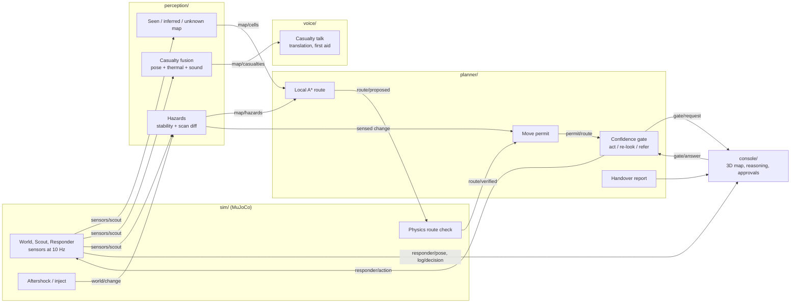
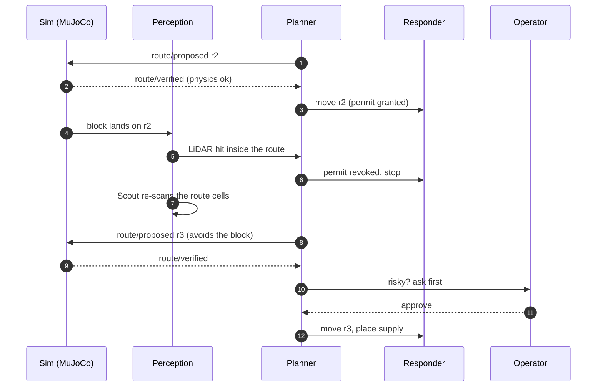

<h1 align="center">AFTERSHOCK</h1>

<p align="center"><b>See first. Check the route. Then send help.</b><br>
A two-robot search-and-rescue agent for collapsed buildings. A light Scout maps the ruin, the system
predicts what may fall next, and a Responder carries supplies in only along routes that physics and a
human have cleared.</p>

<p align="center">Built in one weekend for the <b>AgentVerse 2026 Robotics track</b> (UCL AI Society, London, 7 to 8 November 2026).</p>

<p align="center">
  
  
  
  
  
  
</p>

<p align="center">
  
</p>

<p align="center"><a href="docs/technical-summary.pdf"><b>One-page technical summary (PDF)</b></a> ·
<a href="docs/aftershock.md">Full spec</a> · <a href="coord/CONTRACT.md">Interfaces</a> · <a href="#quick-start">Quick start</a></p>

---

## Contents

- [Why](#why)
- [What it does](#what-it-does)
- [How it works](#how-it-works)
- [Models and where they run](#models-and-where-they-run)
- [Measured results](#measured-results)
- [Quick start](#quick-start)
- [Configuration](#configuration)
- [Tests](#tests)
- [Repository layout](#repository-layout)
- [Safety and limits](#safety-and-limits)
- [Roadmap](#roadmap)
- [Team](#team)
- [Licence and acknowledgements](#licence-and-acknowledgements)

## Why

After an earthquake, rescuers can't see inside a collapsed building, and an aftershock can bring more of
it down on whoever goes in. Time matters: "the vast majority of survivors are brought out within 24 hours
by local teams", and more than 90% within three days (Ilan Kelman, UCL, to AFP, 9 February 2023;
[source](https://www.dailysabah.com/turkey/chances-of-survival-may-be-up-to-a-week-after-earthquakes-experts/news),
an expert comment, not a study). Sending a person or a heavy machine in blind wastes those hours and adds
risk.

AFTERSHOCK splits the job in two. A small Scout, cheap to lose, goes in first and maps. The heavier
Responder moves only when the route it would take has been seen, survives a simulated aftershock, and, if
it is risky, has an operator's yes.

**Who it's for**

- **The USAR team lead or operator.** They decide where it's safe to send people or machines and approve
  risky moves. Their hands are often busy, so every command works by voice or typed.
- **The trapped casualty.** No screen and no login. They hear the Scout call out, answer by tapping or
  speaking, and get supplies and spoken guidance in their own language.
- **The next team in.** They read the handover report: what is safe, who is where, what was approved.

## What it does

**Maps what it has actually seen.** The Scout's LiDAR, depth camera, thermal channel and microphone build
a map whose cells are *seen*, *inferred* or *unknown*. Only seen, free cells can carry a route. A re-look
(sending the Scout back) is a decision the planner makes, not a fallback.

**Finds people without faces.** Casualty position and confidence come from body pose, a warm patch in the
thermal image and the bearing of tapping or speech. Simulated vitals are labelled as simulated.

**Predicts what will fall.** Before any shake, depth points flag blocks that look poorly supported. After
one, a LiDAR scan diff shows what moved. Cells are *stable*, *at risk* or *collapsed*.

**Checks every route with physics.** Local A* proposes a Responder route; MuJoCo shakes the scene against
it. A block that would land on the route rejects it. Passing earns a **move permit**.

**Adapts when the building moves.** Any sensed change (an aftershock, debris that shifts, a block dropped
live from the console) revokes the permit. The Responder stops on the spot, the Scout re-scans, and the
new route is drawn with a one-line reason.

**Delivers and talks.** The Responder carries water, a first aid kit, a radio, a bandage, a splint and a
thermal blanket, and can clear light rubble with its arm. The casualty hears the Scout in their own
language and gets short, cited first aid steps for a human to follow.

**Keeps working offline.** Routing, the confidence gate and the handoff run on the device. A local Gemma 4
model reads goals when the network drops, inside a budget shown live on the console.

**Writes the handover.** At the end of a run it drafts a report from the reasoning log: map, casualties and
confidence, hazards, routes and re-plans, supplies delivered and every approval.

<p align="center">
  
</p>
<p align="center"><sub>The building scene in MuJoCo after an aftershock: the slab and a wall section have come down.</sub></p>

## How it works

Five lanes run as asynchronous Python tasks on one validated topic bus. The browser console connects over a
WebSocket. Each lane talks only through typed topics, so any lane can be replaced by a fake and tested on
its own ([`coord/CONTRACT.md`](coord/CONTRACT.md)).



**What happens when the building moves**



We kept movement out of the language models on purpose. Timers, thresholds, routing and the gate are
ordinary code, so the same seed gives the same decisions. A model answer is logged with a receipt but never
grants movement: only physics and the permit do.

## Models and where they run

| Function | Model or method | Runs on | Measured latency or budget |
|---|---|---|---|
| Routing, confidence gate, handoff | Local A*, rule-based gate | Device | under 50 ms per step |
| Offline goal reading | Gemma 4 E2B (`gemma4:e2b`, Q4_K_M) via Ollama 0.40.15 | Device | 1.8 to 2.8 s warm, 19 s cold (pre-warmed); 4.1 GB resident. Budget 5,000 MB and 4,000 ms per step, metered live |
| World, sensors, route check | MuJoCo 4.0.0 | Device | 0.6 to 0.9 ms per 2 ms physics step |
| Mapping, casualty fusion, hazards | Python | Device | 15.7 ms per sensor frame (970-frame replay) |
| Camera check, casualty talk, translation, report | `gemini-3.8-flash` | Cloud, optional | Advisory only. Every call logs a receipt with its wall time; capped at 300 calls an hour |
| Spatial look points, approval routing | `gemini-robotics-er-2-preview`, `gemini-3.5-flash-lite` | Cloud, optional | as above |
| Operator voice, photo to scene | `gemini-3.8-live` with `gemini-3.8-flash-tts`, `gemini-4-argon` | Cloud, optional | as above |

"Device" is the demo laptop: CPU only, 8 GB RAM, no GPU (WSL2, 12 threads). With `GEMINI_MODE=off` every
cloud feature falls back to a local stand-in and the whole run still completes. On real robots the planner
would run on a Jetson Orin NX 16 GB ([`docs/hardware.md`](docs/hardware.md)).

## Measured results

From runs on 8 November 2026, `GEMINI_MODE=off`, auto-approve.

| Run | Result |
|---|---|
| Backup scene, 150 s, aftershock at 75 s | Supplies placed beside the casualty; re-plan 4 s after the aftershock; no hub errors |
| Tower scene, same | Water 0.09 m from the casualty; re-plan 0.2 s after the aftershock; no hub errors |
| Building scene, same | Water 0.19 m from the casualty; re-plan 0.2 s after the aftershock; no hub errors |
| Aftershock on a live route (B1 run) | Block lands 50.1 s, permit revoked 50.1 s, re-granted after a fresh check 52.3 s, moving again 53.1 s (sim time) |
| B1 end-to-end checks | Seeds 3, 4, 5, 18 and 19 pass 17/17 (seed 3 has also scored 15/17 on a rerun) |
| Multi-level descent to B2 | Seeds 0 to 4 pass 9/9: the Scout descends, maps a dropped slab, re-routes and reaches the casualty |

The test suites hold about 900 Python tests and 36 browser tests. A baseline comparison harness and its raw
results are in [`eval/`](eval/).

## Quick start

**Requirements:** Python 3.12, Node.js 20.19 or later (for Vite 7), and a CPU that can run MuJoCo (no GPU needed). Linux,
macOS or WSL2. Optional: [Ollama](https://ollama.com) with `gemma4:e2b` for the offline planner, and a
`GEMINI_API_KEY` for the cloud features.

```bash
git clone https://github.com/TYK3/agentverse-2026
cd agentverse-2026

python -m venv .venv && source .venv/bin/activate
pip install -r requirements.txt -r coord/requirements.txt
pip install -r voice/requirements.txt        # optional: live voice
(cd console && npm install)
```

**Run the whole rescue** (hub, every lane and the console, then a replay of the run):

```bash
python tools/demo.py --scene backup --auto-approve --duration 150 --shift-at 75
```

The console opens at `http://127.0.0.1:5173`; the hub serves `ws://127.0.0.1:8000/ws`. Leave out
`--auto-approve` to answer the approval cards yourself. `--shift-at` drops the aftershock in mid-run; the
**Simulate Re-Plan** button in the console does the same whenever you like. Scenes: `backup`, `tower`, `building`.

**Replay a recorded run** in story mode:

```bash
python tools/demo.py --replay console/public/runs/<file>.jsonl
```

**Run the hub on its own** (for example to connect your own client):

```bash
SIM_SCENE=backup uvicorn coord.hub:app --port 8000
```

## Configuration

| Variable | Default | What it does |
|---|---|---|
| `GEMINI_MODE` | `off` | `off` uses local stand-ins, `replay` uses cached answers, `live` calls the API |
| `GEMINI_API_KEY` | none | Read from the environment or `.env`, never from code |
| `GEMINI_CAP_PER_HOUR` | `300` | Hard cap on live Gemini calls |
| `SIM_SCENE` | `backup` | `backup`, `tower`, `building`, or a path to an MJCF file (`tools/demo.py` defaults to `building`) |
| `SIM_CLOCK` | `wall` | `step` advances a fixed time per tick for repeatable runs |
| `HUB_PROCESSES` | off | `1` runs the sim lane in its own process, so a slow planner step can't stall physics |
| `PLANNER_LOCAL_MODEL` | `gemma4:e2b` | The Ollama model for offline goal reading |
| `OLLAMA_HOST` | Ollama's default | Where the local model is served |

## Tests

Each lane has its own check (lint plus tests), and CI runs the same scripts:

```bash
bash sim/check.sh
bash perception/check.sh
bash planner/check.sh
bash voice/check.sh
bash coord/check.sh
bash console/check.sh        # TypeScript build, smoke test, Playwright
```

For a quick pass on one lane: `GEMINI_MODE=off python -m pytest -q sim/tests`.

## Repository layout

| Path | What's there |
|---|---|
| [`sim/`](sim/) | MuJoCo scenes (backup, tower, building, multi-level), Scout and Responder models, sensors, the aftershock, the physics route check |
| [`perception/`](perception/) | The seen/inferred/unknown grid, exploration, casualty fusion, hazard prediction, triage |
| [`planner/`](planner/) | A* routing, the confidence gate, move permits, the Responder handoff, the offline Gemma planner, the edge budget, the handover report |
| [`voice/`](voice/) | Operator voice, casualty contact and translation, cited first aid, emergency call preparation |
| [`console/`](console/) | The operator console: 3D map, routes, reasoning log, budget meter, approvals, typed commands, story replay |
| [`coord/`](coord/) | The topic bus and hub, message schemas, the Gemini wrapper with receipts, the interface contract |
| [`hw/`](hw/) | Bridges toward real hardware (not used in the demo) |
| [`tools/`](tools/) | The demo launcher, run and evaluation scripts, the team board |
| [`eval/`](eval/) | Baseline evaluation harness and results |
| [`docs/`](docs/) | Spec, technical summary, hardware and electronics concepts, the [team board manual](docs/team-board.md) |

## Safety and limits

- **A model never authorises movement.** Physics, a fresh scan and, for risky moves, the operator do.
- **Risky moves and any emergency call need an explicit operator yes.** Every decision is logged with its
  perception, model, physics result and outcome.
- **No faces, no diagnosis.** Casualty vitals are simulated and labelled; first aid is cited guidance for a
  human, not treatment.
- **Simulation only.** Hazard and casualty outputs are estimates, not engineering or medical advice. The sim
  robots are smaller than the real hardware they stand for (a real Jackal needs doorways of about 0.8 m).
  Real deployment would need independent validation.

## Roadmap

| Area | This weekend | Next |
|---|---|---|
| Environment | Three MuJoCo scenes plus a multi-level descent | Scenes built from photos of real sites; fire and flood |
| Scout | Simulated LiDAR, depth, thermal, sound | AgileX LIMO Pro with a LoRa relay for deep coverage |
| Responder | One arm, light rubble only | Clearpath Jackal with a Kinova Gen3 lite; heavier clearing |
| Hazards | Physics-based estimate | Structural models validated with engineers |
| Autonomy | Local planner within a stated budget | Full on-robot autonomy on Jetson Orin |

The hardware concept, with sources for every part, is in [`docs/hardware.md`](docs/hardware.md) and
[`docs/electronics.md`](docs/electronics.md).

## Team

Built at AgentVerse 2026 by Anthony ([@TYK3](https://github.com/TYK3), team lead), Philbert
([@PhillysTheBest](https://github.com/PhillysTheBest)), Alif ([@AlifKhan03](https://github.com/AlifKhan03)),
Charlotte ([@Camellia526](https://github.com/Camellia526)) and Abia ([@13abiazt-a11y](https://github.com/13abiazt-a11y)).

Each of us worked with our own coding agents. They coordinated on a shared message board, one pinned
GitHub issue, so one person's agent could ask another's about an interface without anyone relaying it by
hand. How it works: [`docs/team-board.md`](docs/team-board.md) and [`AGENTS.md`](AGENTS.md).

## Licence and acknowledgements

MIT, see [`LICENSE`](LICENSE).

Physics by [MuJoCo](https://mujoco.org); 3D console by [Three.js](https://threejs.org); local model by
[Gemma](https://ai.google.dev/gemma) on [Ollama](https://ollama.com); cloud models from the Gemini API.
Third-party 3D asset credits are listed in the console (**3D asset credits**).

AFTERSHOCK is a hackathon prototype in simulation. It is not a certified rescue system and must not be used
to make real rescue decisions.
