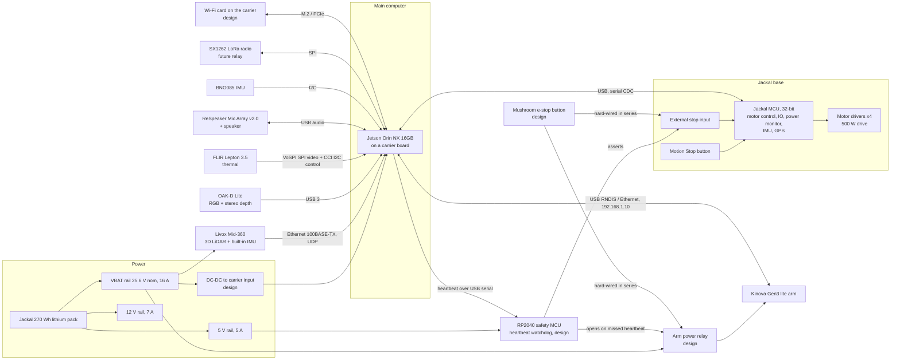
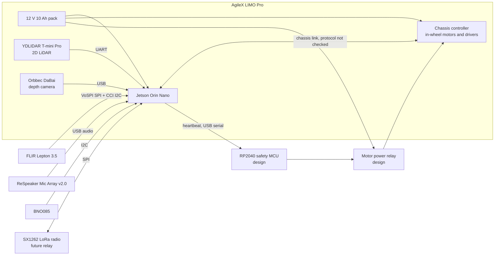

# AFTERSHOCK rover electronics (Y10)

How the parts in [`docs/hardware.md`](hardware.md) connect: the main computer, the motor and
safety microcontrollers, each sensor on its real interface, the motor drivers, power and the stops.
Checked 7 Nov 2026. Every interface links to a source; design choices of ours are marked **design**,
and anything we could not confirm is listed under "Not checked".

## Responder

| Link | Interface | Rate | Source |
|---|---|---|---|
| Jetson to Jackal MCU | Full Speed USB, the MCU is a standard serial CDC device; the MCU does motor control, IO, power monitoring and supplies IMU and GPS data | status at 1 Hz, stop changes published at once | [Jackal user guide (Generation Robots)][jackal-guide], [jackal_msgs/Status][jackal-status] |
| Motion Stop and external stop | Button on the base toggles the motors between engaged and disengaged; the MCU reports `driver_external_stop_present` and `driver_external_stop_stopped` | on change | [Jackal user guide][jackal-guide], [jackal_msgs/Status][jackal-status] |
| Livox Mid-360 | 100BASE-TX Ethernet over a 12-pin M12 connector that also carries power, UDP data, PTP v2 (IEEE 1588-2008) or GPS PPS time sync, built-in ICM40609 IMU at 200 Hz | IMU 200 Hz; point-cloud rate not checked | [Livox Mid-360 specs][mid360], [Mid-360L reseller page (same connector family)][mid360l] |
| OAK-D Lite | USB-C, USB 2 or USB 3 (5 Gbps) | colour and depth per camera mode | [OAK-D Lite spec sheet][oakd] |
| FLIR Lepton 3.5 | VoSPI (SPI, up to 20 MHz) for video, CCI (I2C-like) for control | 8.7 Hz (export-compliant) | [Lepton 3/3.5 datasheet][lepton], [Lepton vs Lepton 3 app note][lepton-note] |
| ReSpeaker Mic Array v2.0 | USB Audio Class 1.0, direction of arrival read over USB control | sample rate not checked | [Seeed wiki][respeaker] |
| BNO085 | I2C (also SPI or UART-RVC) | rotation vector up to 400 Hz | [Adafruit 4754][bno085] |
| Kinova Gen3 lite | USB (RNDIS) or Ethernet through a USB-A to Ethernet adapter; fixed address 192.168.1.10 | Kortex API | [Clearpath Gen3 lite docs][gen3lite-docs] |
| SX1262 | SPI | LoRa up to 62.5 kbps | [Mouser SX1261/2 page][sx1262] |
| RP2040 safety MCU | USB serial to the Jetson; GPIO to relay drivers | heartbeat 10 Hz, design | [RP2040 specs][rp2040] |

**Power** (rails from the [Jackal user manual][jackal-manual]): the arm (21 to 30 V, 24 V nominal) and the
Mid-360 (9 to 27 V) run straight off VBAT; the Jetson carrier runs from a DC-DC converter on VBAT
(**design**: the carrier's input range depends on the carrier chosen); the RP2040, IMU and LoRa run
from 5 V; USB devices are powered by the Jetson. Peak budget on VBAT: arm 100 W peak (legacy Clearpath
page) + Mid-360 14 W peak at start-up + Jetson 25 W = 139 W, about 5.4 A at 25.6 V, inside the 16 A rail.

**Stops** (**design**, built on the Jackal's own stop):
1. The Jackal's Motion Stop button disengages the motors through its MCU.
2. A mushroom e-stop button is hard-wired in series with the external stop input and the arm power
   relay, so pressing it stops the wheels and drops arm power without any software.
3. The RP2040 watches a 10 Hz heartbeat from the Jetson. If three are missed (300 ms) it asserts
   the external stop and opens the arm relay.
4. In software, the planner's human gate and route check stay the first line (see `docs/aftershock.md`).

## Scout unit

| Link | Interface | Rate | Source |
|---|---|---|---|
| YDLIDAR T-mini Pro | UART | 6 to 12 Hz scan, 4000 samples/s | [T-mini Pro datasheet][tmini] |
| Orbbec DaBai | USB (in the LIMO Pro) | not checked | [LIMO Pro guide][limo-pro] |
| Chassis controller | AgileX in-wheel motors (18 V rated) with their own drivers; the LIMO's link protocol is not documented in what we found | - | [LIMO Pro guide][limo-pro] |
| Lepton 3.5, ReSpeaker, BNO085, SX1262 | as on the Responder | as on the Responder | see the Responder table |

**Stops:** the Scout's own stop is the chassis command timeout plus a relay on the motor supply that
the RP2040 opens on a missed heartbeat (**design**; it assumes the motor feed can be broken outside
the LIMO's controller, which we have not checked). The Scout only looks and carries nothing, so its
risk is lower than the Responder's.

## Not checked

- The LIMO Pro's chassis link (other AgileX bases use CAN or RS232 and stop after 500 ms without a
  command, per the [SCOUT 2.0 manual][scout2]; we did not confirm the LIMO does the same) and its
  internal power wiring.
- The Jackal's external stop wiring (pin-out and logic level) and whether its wireless controller acts
  as a stop.
- The Jetson carrier's input voltage; it depends on the carrier picked.
- The ReSpeaker v2.0 is USB, not I2S. An I2S array would need a different part.

[jackal-guide]: https://www.generationrobots.com/media/Jackal_Clearpath_Robotics_Userguide.pdf
[jackal-status]: https://docs.ros.org/en/api/jackal_msgs/html/msg/Status.html
[jackal-manual]: https://docs.clearpathrobotics.com/docs_robots/outdoor_robots/jackal/user_manual_jackal
[mid360]: https://www.livoxtech.com/mid-360/specs
[mid360l]: https://openelab.io/de/products/livox-mid-360l-3d-lidar
[oakd]: https://cdn.shopify.com/s/files/1/0630/8950/8583/files/OAK-D-Lite_Spec_Sheet.pdf
[lepton]: https://www.mouser.com/datasheet/2/227/Lepton3_3_5_Data_Sheet-2580086.pdf
[lepton-note]: https://gigaplus.makeshop.jp/ctlecommerce/CTL_products/102-2012-100-01%20Lepton%20vs%20Lepton%203%20App%20Note.pdf
[respeaker]: https://wiki.seeedstudio.com/ReSpeaker_Mic_Array_v2.0
[bno085]: https://adafruit.com/product/4754
[gen3lite-docs]: https://docs.clearpathrobotics.com/docs_robots/legacy/ros1_robots/accessories/manipulators/kinova_gen3_lite
[sx1262]: https://www.mouser.in/semtech-sx1261-2-lora-transceivers/
[rp2040]: https://www.raspberrypi.com/products/rp2040/specifications/
[tmini]: https://stgaws.robu.in/wp-content/uploads/2022/11/YDLIDAR-T-mini-Pro-Data-Sheet_V0.2.0-220831.pdf
[limo-pro]: https://westonrobot.github.io/docs-legacy/_sources/robot_user_guide/agilex/limo_pro.rst.txt
[scout2]: https://agilexrobotics.gitbook.io/scout2.0/3-getting-started
